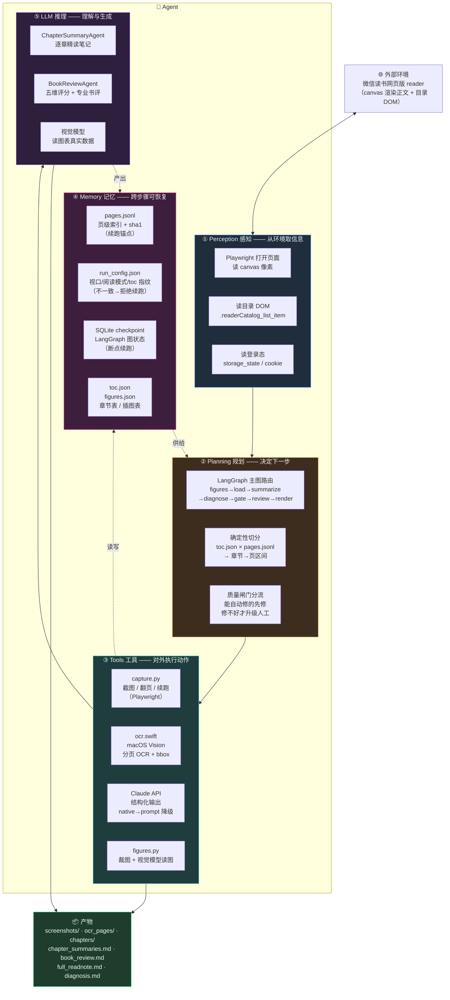
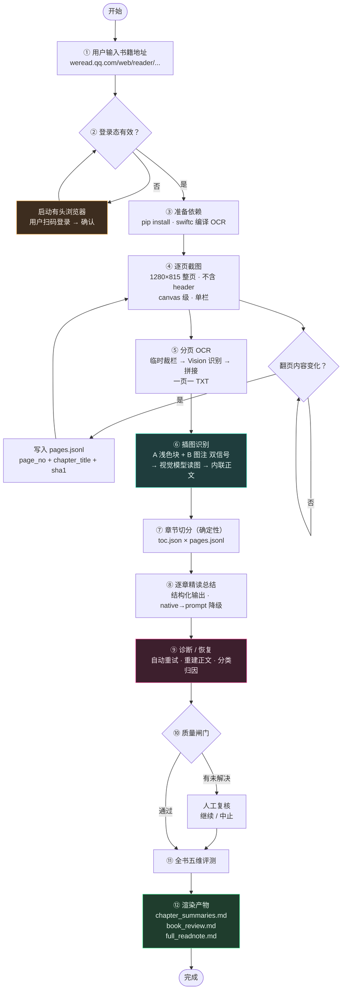
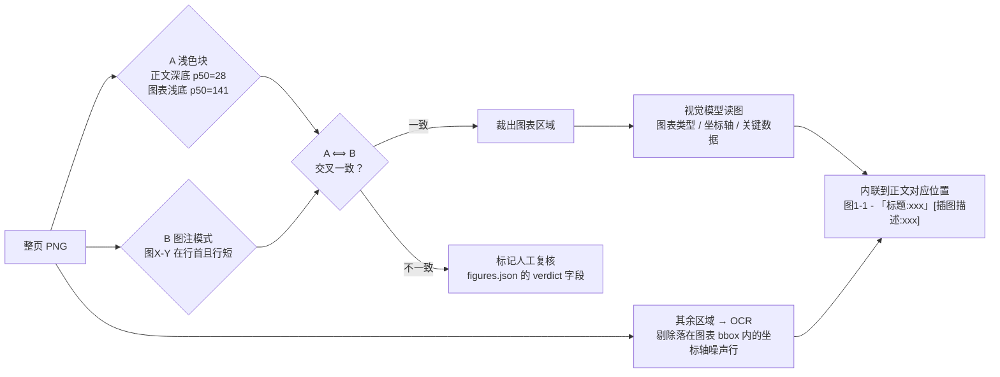

# 微信读书全书 OCR 总结 Agent

输入一个微信读书 reader URL，输出：**逐页截图 → 分页 OCR → 插图识别 → 逐章精读笔记 → 全书五维评测报告**。

> 全 Python 实现。OCR 用 macOS Vision（`utils/ocr.swift`，编译成独立二进制被 Python 调用）。
> 也可作为 **Claude Code 插件**安装（见 [安装](#安装)）。

---

## 架构图

### Agent 五大部件



### 各部件在本项目里的落点

| 部件 | 本项目的实现 | 为什么这么设计 |
|---|---|---|
| **① Perception 感知** | `capture.py` 打开 reader 页；读 canvas 像素、`.readerCatalog_list_item` 目录 DOM、`storage_state.json` 登录态 | 正文只存在于 canvas，DOM 里没有正文 → 感知必须走像素；目录 DOM 是权威章节表，免费拿到 |
| **② Planning 规划** | LangGraph 主图路由 + **确定性**章节切分（目录 × 每页章节号）+ 质量闸门分流 | 章节切分是**规划**而非推理：目录 × 章节号交叉即可，零 LLM、零编造风险 |
| **③ Tools 工具** | `capture.py`（Playwright）、`ocr.swift`（Vision OCR）、Claude API（结构化输出）、`figures.py`（裁图+视觉） | 工具层全是确定性代码；**工具失败要能被诊断节点分类重试**（json_invalid / truncated / rate_limit…） |
| **④ Memory 记忆** | `pages.jsonl`（页级索引+sha1）、`run_config.json`（视口/模式/toc 指纹）、SQLite checkpoint（LangGraph 图状态）、`toc.json`/`figures.json` | 记忆是**文件态**而非内存态：进程崩了、网络断了、换机器继续都能接上。指纹不一致直接拒绝续跑，避免静默错位 |
| **⑤ LLM 推理** | `ChapterSummaryAgent`（逐章笔记）、`BookReviewAgent`（五维评分+书评）、视觉模型（读图表数据） | 只在"需要理解与生成"的地方用模型；结构化输出带 native→prompt 降级，第三方端点不强制 JSON 也能跑 |

> **分层原则**：采集层（Perception + Tools）全是确定性代码，**不进 LLM、不进 checkpoint 图**；
> 认知层（Planning + LLM）才用模型。这样既能断点续跑，又不会让模型去干它不擅长（也不该干）的确定性活。

## 工作流程图



**插图分流（M8）的判定与处理**：



---

## 安装

### 作为 Claude Code 插件（推荐）

```bash
# 1) 添加 marketplace
/plugin marketplace add sukunwei/reading-agent

# 2) 安装插件
/plugin install reading-agent@reading-agent
```

装完就有 `/read-book` 命令。

<details>
<summary>本地开发安装（不走 marketplace）</summary>

```bash
git clone https://github.com/sukunwei/reading-agent.git
cd reading-agent
pip install -r requirements.txt
swiftc -O utils/ocr.swift -o utils/bin/ocr
```

在 Claude Code 里用 `--plugin-dir` 加载：
```bash
claude --plugin-dir /path/to/reading-agent
```
</details>

### 独立使用（不用插件）

```bash
git clone https://github.com/sukunwei/reading-agent.git && cd reading-agent

pip install -r requirements.txt
swiftc -O utils/ocr.swift -o utils/bin/ocr   # OCR 引擎（macOS Vision）
cp .env.example .env && $EDITOR .env     # 填 ANTHROPIC_API_KEY / ANTHROPIC_AUTH_TOKEN
```

> OCR 需要 **macOS**（Apple Vision）。其他平台把 `agent/ocr.py` 里的 OCR 调用换成
> PaddleOCR / RapidOCR 即可，其余代码不变。

---

## 使用方法

### 插件方式

```
/read-book
```

或者：

```
/read-book https://weread.qq.com/web/reader/95332ad0813ab8705g016ce7kc81322c012c81e728d9d180
```

命令会依次做这些事：

1. **询问书籍地址** —— 没给就问你（要的是 reader 地址，不是书名页地址）
2. **检查登录态** —— 没有或失效就弹出有头浏览器，**你扫码登录**，脚本自动检测到并保存；
   登录不成功会停下来问你，不会静默产出半本书
3. 采集整本 → OCR → 插图识别 → 逐章精读 + 全书评测
4. 汇报产物路径与质量指标

也可以直接对 Claude Code 说「帮我读一下这本书：`<URL>`」，`reading-agent` skill 会自动触发。

### 命令行方式

产物目录**由你指定**，不在 agent 内部创建：

```bash
export OUT_DIR="$HOME/Documents/读书"    # 想放哪就放哪

# 1) 登录（有头浏览器扫码；或从运行中的 Chrome 免扫码提取）
#    登录态默认放 ~/.reading-agent（READING_AGENT_AUTH 可改）
python3 capture/login.py
#   python3 capture/extract_chrome_cookies.py

# 2) 采集整本（中断后重跑同一条命令即可续跑）
python3 capture/capture.py --book-url "<BOOK_URL>" --out-dir "$OUT_DIR"

# 3) OCR + 质量闸门
python3 agent/ocr.py --out-dir "$OUT_DIR"

# 4) 认知层全链路（LangGraph）
python3 agent/cli.py <书名关键字> --out-dir "$OUT_DIR"
```

> 三个命令的 `--out-dir` 必须一致。
> 不传时默认 `$PWD/reading-output`（当前工作目录下，**不在 agent 目录里**）；
> 也可用环境变量 `READING_AGENT_OUT` 统一设置。

其它入口：

```bash
python3 agent/cli.py --list --out-dir "$OUT_DIR"          # 列出已采集的书
python3 agent/cli.py <书名> --stage ocr --out-dir "$OUT_DIR"   # 只跑某一步
python3 agent/cli.py <书名> --resume --out-dir "$OUT_DIR"      # 断点续跑
python3 agent/cli.py <书名> --mock --out-dir "$OUT_DIR"        # 离线跑（不调 API）
python3 capture/capture.py --resume --out-dir "$OUT_DIR"       # 采集续跑
```

---

## 仓库结构

```
.claude-plugin/       插件清单（plugin.json + marketplace.json）
.claude/skills/       项目级 skill
  ├── reading-agent/     ← 本项目自己的 skill（插件复用同一份）
  ├── coding-standards/  ← python-best-practices
  ├── tooling/
  └── testing/
commands/            /read-book 命令
CLAUDE.md            项目操作记忆（硬约束 / 角色定义 / 排查表）
capture/             采集层（Playwright）
agent/               认知层（LangGraph）+ report.py
shared/              两层共用：paths.py（路径解析）+ stages.py（计时/token 台账）
utils/               非 Python 的工具：ocr.swift（OCR 引擎，macOS Vision）+ bin/ 编译产物
```

---

## 产物

```
<OUT_DIR>/<书名>/
├── screenshots/<NNN_章名>/page_NNNN.png    整页截图 1280×815（不含 header）
├── ocr_pages/<NNN_章名>/page_NNNN.txt      一页一 TXT，与 PNG 一一对应
├── figures/figures.json                    插图记录（编号 / 标题 / bbox / 视觉描述）
├── quality_report.json                    OCR 覆盖率 / 置信度 / 闸门结果
├── diagnosis.md + diagnosis.json          诊断与自动恢复报告
├── chapters/<NNN>.json / <NNN>.md          单章总结（可单章重跑）
├── chapters.json                          章节 → 页区间映射
├── chapter_summaries.md                   逐章精读笔记
├── book_review.md                         全书五维评分 + 专业书评
├── full_readnote.md                       整合版读书资产
└── full_text.txt                          清洗后全文
```

---

## HTML 报告

流水线最后会生成一份自包含的 HTML 报告：`<OUT_DIR>/<书名>/report.html`

```bash
python3 agent/report.py --book <书名> --out-dir "$OUT_DIR"      # 随时离线重建
python3 agent/report.py --book <书名> --external                # 不内嵌 echarts（HTML 更小）
```

> **直接双击 `report.html` 就能看，不需要起 HTTP 服务。**
> 默认 ECharts 已内嵌进 HTML（1.4 MB），整个文件自包含 —— 复制到任何地方、发给谁都行。
> `--external` 则改为引用 `<OUT_DIR>/assets/echarts.min.js`，HTML 更小但不能单独复制走。

**报告包含 5 块**：

| 块 | 内容 |
|---|---|
| ① 概览 | 评分/评级、章节数、页数、字数、OCR 覆盖率、插图数（耗时与 Token 在有埋点数据时才会出现） |
| ② 五维评分 | CSS 条形 + ECharts 雷达图 |
| ③ 全书评测 | 整体定位 + 五维依据全文 + 优势/短板/适合人群/阅读建议 |
| ④ 逐章精读笔记全文 | 60 章完整精读笔记（可折叠展开） |
| ⑤ 附录 | 环境信息、产物清单、数据来源说明 |

**图表库本地化**：ECharts 首次使用时下载到 `<OUT_DIR>/assets/echarts.min.js`，
默认**内嵌进 HTML**（不依赖 CDN、不依赖 assets 目录，单文件自包含）。
（`--no-echarts` 可退回纯 CSS 条形。）

**可离线重建**：报告只读既有产物与 `.state/` 里的埋点，**不重跑流水线** ——
重跑一次要 1 小时，报告必须能单独重生成。

---

## 关键设计

| 决策 | 原因 |
|---|---|
| OCR 而非取 DOM 文本 | 正文渲染在 `<canvas>` 上，DOM 里没有正文（实测全页可见文本仅 4 字符） |
| 整页截图 1280×815、`device_scale_factor=1` | DSF=2 时 reader 按设备像素排版而画布只留 CSS 尺寸 → 正文被切字 |
| 强制「上下滚动双栏」阅读模式 | 该模式底部有明确的翻页按钮；模式会被持久化，必须显式切换并校验 |
| OCR 前按 canvas 边界临时裁栏 | 整页左右两栏，Vision 按 y 分行会把两栏同行并成一行 → 阅读序错乱（实测 8.2% 的行跨栏） |
| 插图判定用**两路信号交叉** | 浅色块（图像层）+ 图注模式（文本层），单用任一个都会误判 |
| 章节切分用确定性节点 | 目录（站点自带）× 每页章节号（DOM 免费）交叉即可，零编造、零 token |
| 采集层不进 LangGraph | 采集是长时确定性任务，不该进 checkpoint 图；LangGraph 只管认知层 |
| 结构化输出带降级路径 | 部分 Anthropic 兼容端点接受 `output_config.format` 但不强制 → native 失败自动降级为「提示词 JSON + 本地校验 + 修复重试」 |
| 默认模型不写死 | 走第三方端点时 `claude-opus-5-5` 会 404 → `LLM_MODEL` → `ANTHROPIC_MODEL` → 官方默认 |
| 逐章总结默认 **2 个 worker 并行** | 实测 8 章：串行 34.0s/章 vs 并行 14.1s/章（**2.4×**）。`LLM_WORKERS` 可调。⚠️ 并行前必须先 `warmup()` 探测原生结构化输出，否则多个 worker 会一起卡在那个会挂起的原生路径上 |
| 插图识别走**批量**（6 图/批） | 实测单图 38s/张 vs 批量 2.6s/张（**14×**）。整本 102 张图：65 分钟 → 5 分钟 |

---

## 合规

仅用于个人已购书籍的离线阅读辅助。

- `state/` 含明文登录会话、`.env` 含 API 凭据 → **均已在 `.gitignore` 中，不要提交**
- 产物不外传
